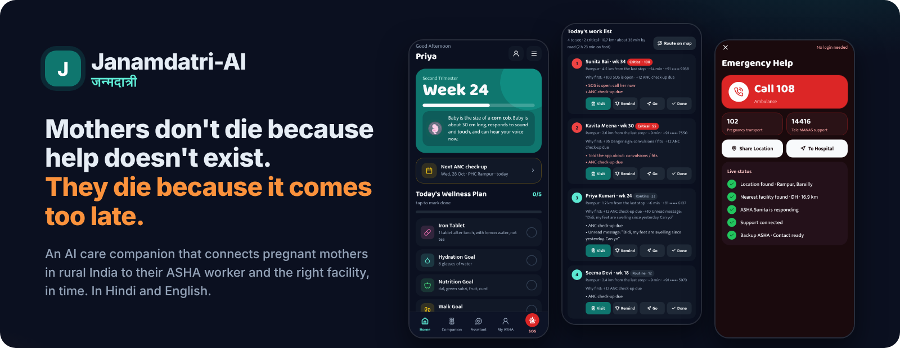
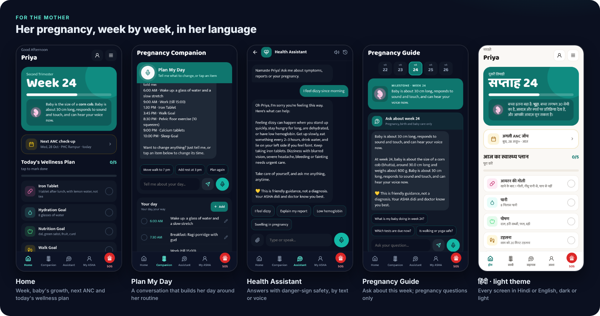
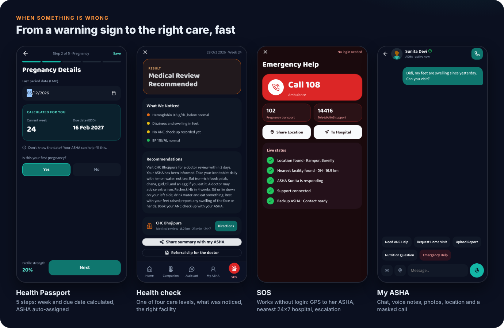
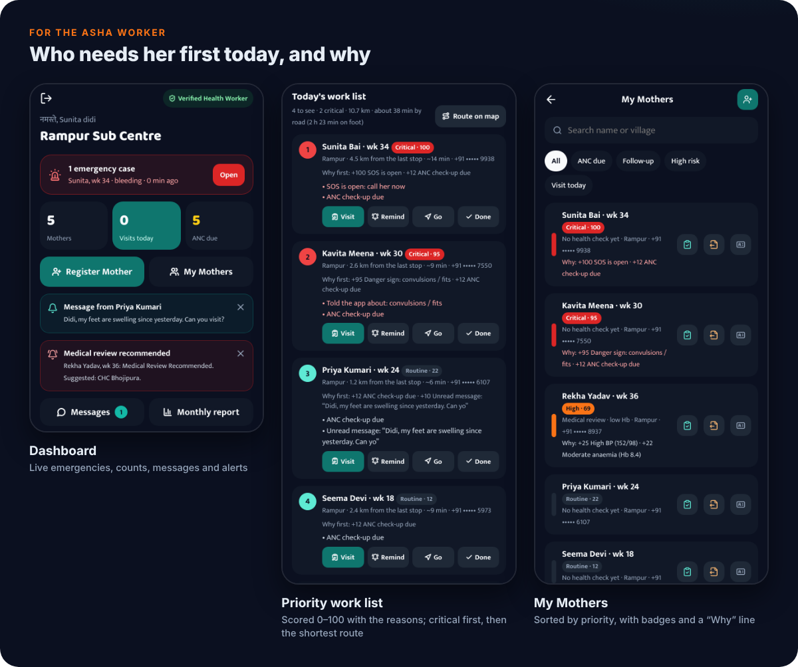
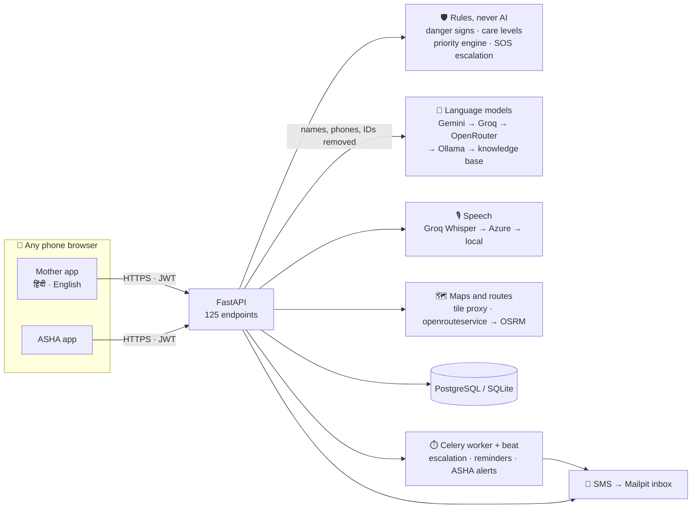
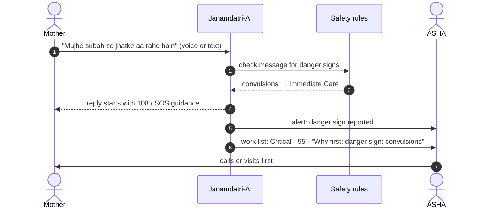

<div align="center">



# Janamdatri-AI · जन्मदात्री

**An AI care companion for pregnant mothers in rural India, connecting them to their ASHA worker and the right facility, in time.**


[The problem](#-the-problem) · [What it does](#-what-it-does) · [Screens](#-screens) · [Quick start](#-quick-start) · [Demo logins](#-demo-logins) · [How it works](#-how-it-works) · [Docs](#-documentation)

</div>

---

## 🩺 The problem

Most pregnancy deaths in India can be prevented. The real problem is the **time lost** between the first warning sign and the right care.

| **113** | **52 %** | **4 in 10** |
|:---:|:---:|:---:|
| mothers die per 1,00,000 live births in Rajasthan<br><sub>SRS 2018–20 (India: 97)</sub> | of pregnant women in India are anaemic<br><sub>NFHS-5, 2019–21</sub> | mothers miss the recommended 4+ ANC check-ups<br><sub>NFHS-5</sub> |

The time is lost in a chain of four delays:

1. **Not recognised.** She can't tell a danger sign from a normal symptom, or keeps it to herself.
2. **Found late.** Check-ups are missed, so anaemia and high BP go unnoticed between visits.
3. **Not followed up.** One ASHA cares for many families on paper registers. She can't see who needs her most today.
4. **Wrong place, too slow.** In an emergency the family loses time deciding which hospital can actually help.

## ✨ What it does

Janamdatri-AI attacks each delay, in Hindi or English, on any phone browser:

| Delay | What Janamdatri-AI does |
|---|---|
| Not recognised | **Health Assistant** and **health check** spot danger signs in Hindi, English and Hinglish, by text or voice. The answer is one of four care levels, never a percentage. |
| Found late | **Health Passport** with week and due date, ANC reminders, report reading (photo or PDF), haemoglobin trend, and a **Plan My Day** companion for food, iron tablets, water, walk and rest. |
| Not followed up | The ASHA gets a **priority work list**: every mother scored 0–100 with the reasons, critical first, then the shortest route. Also voice visit notes, alerts and a monthly report for the ANM. |
| Wrong place, too slow | **SOS without login** sends her GPS to her ASHA, finds the nearest 24×7 facility that can handle it, and escalates to the backup ASHA, the ANM and the facility if nobody answers. |

> [!IMPORTANT]
> Janamdatri-AI **supports, and never replaces**, doctors, ANMs and ASHA workers. Emergencies, care levels and priorities come from **explainable clinical rules**, never from an AI model.

## 📱 Screens







<details>
<summary><b>Full feature list</b></summary>

**Mother**
- **Health Passport** in 5 steps (about you, pregnancy, medical history, reports, emergency contacts). Week and due date are calculated, and an ASHA worker is assigned automatically by village, sub-centre, pincode and distance.
- **Home:** week, baby's growth, next ANC check-up and today's wellness plan.
- **Plan My Day:** a conversation, typed or spoken. She describes her day and the companion builds it around her routine. She can change it in words ("move walk to 7 pm").
- **Health Assistant:** questions by text, voice or report upload, with danger-sign safety and grounded answers from a 230-topic knowledge base.
- **Pregnancy Guide:** this week's milestone, plus "Ask about week N", which answers pregnancy, birth and newborn questions only.
- **Health check:** one of four care levels (Routine Monitoring, Needs Attention, Medical Review Recommended, Immediate Care Recommended), what was noticed, the right facility and a referral slip.
- **Talk To Me:** a private emotional companion.
- **My ASHA:** chat, voice notes, photos, location and a number-masked call.
- **Nearby care map** with road routes, and **SOS**.
- A shared-phone PIN for family phones, Hindi or English, and dark or light theme.

**ASHA worker**
- **Dashboard:** live emergencies, counts and alerts.
- **My area by GPS:** nearby mothers without an ASHA are connected to her, shown on a map coloured by care level.
- **Priority work list:** the 0–100 score and reasons, with Remind (app + SMS), Done, Go and a numbered route on the map.
- **My Mothers:** search, filters and priority badges. **Register a mother** and fill her passport on her behalf.
- **Voice visit notes:** "BP 130 by 85, Hb 9.5, pair mein sujan…" fills BP, Hb, symptoms, checklist and the next visit for her to check.
- **Referrals** to a PHC, CHC or district hospital.
- **Monthly report** for the ANM: CSV, print, or an SMS summary, with estimated JSY and HBNC incentives.
- **Automatic alerts:** the work list at 7:30 AM, "ASHA visits tomorrow" to mothers at 6:30 PM, and a weekly "no news from this mother" alert.

</details>

## 🚦 The priority engine

Every mother gets a score from 0 to 100 that says how urgently she needs her ASHA. It runs on **rules only, no AI**, so every point is shown to the ASHA ("Why first: +95 Danger sign: convulsions") and can be audited.

| Trigger (sets the score) | Score |
|---|:---:|
| SOS is open | **100** |
| A danger sign or self-harm thought told to the app in the last 3 days, not visited since | **95** |
| Immediate Care health-check result, not yet followed up | **90** |

Without a trigger, points add up and stop at **89**, so a mother with many small problems never outranks an emergency:

| Points from | Examples |
|---|---|
| Findings (last 60 days) | Hb < 7 **+35**, < 9 +22, < 11 +10 · BP ≥ 160/110 **+40**, ≥ 140/90 +25 · high sugar +12 |
| Care level not followed up | Medical Review +45 · Needs Attention +20 · a danger sign needing a check today +35 |
| Stage and history | past the due date +20 · first week after birth +15 · twins +12 · age < 18 or > 35 +10 · previous C-section or complications · known conditions |
| Follow-up gaps | newborn visit day, late follow-up, ANC overdue, new flagged report, unread message, missed iron tablets, not seen for a month |

**Bands:** 🔴 Critical ≥ 90 · 🟠 High 60–89 · 🟡 Medium 30–59 · ⚪ Routine < 30. Critical mothers are listed first by score; the rest by band, then by the shortest route. Thresholds follow WHO and MoHFW guidance. The rules are in [`backend/app/asha/priority.py`](backend/app/asha/priority.py).

## 🚀 Quick start

<details open>
<summary><b>Option A · Docker (recommended)</b></summary>

Needs [Docker Desktop](https://www.docker.com/products/docker-desktop/).

```bash
git clone <this-repo-url> && cd janamdatri-ai
cp .env.example .env            # Windows PowerShell: Copy-Item .env.example .env
docker compose up -d --build
```

This starts the web app and API, PostgreSQL, Redis, a Celery worker and scheduler, and Mailpit (the local SMS inbox).

</details>

<details>
<summary><b>Option B · One script, no Docker</b></summary>

Needs **Python 3.11–3.13**. It uses SQLite and needs no Redis; Mailpit is downloaded automatically.

```bash
./run_local.sh          # Windows: run_local.bat
```

</details>

Then open:

| | URL |
|---|---|
| 🌐 Landing page | http://localhost:8000 |
| 📱 The app (mother and ASHA) | http://localhost:8000/app.dc.html |
| 💬 SMS inbox: OTPs and alerts arrive here | http://localhost:8025 |
| 📚 API reference (Swagger) | http://localhost:8000/docs |
| ❤️ Health and provider status | http://localhost:8000/health |

> [!NOTE]
> **No real SMS is ever sent.** Every text (OTPs, ASHA and family alerts, referral notices) lands in the local Mailpit inbox. To use a real gateway later, change one function: `send_sms` in [`backend/app/notifications/sms.py`](backend/app/notifications/sms.py).

To update after pulling new code: `docker compose up -d --build`, then hard-refresh the browser (Ctrl+F5). Your data stays in the Docker volumes.

## 🔑 Demo logins

Login and Sign Up both start with **Who are you?**: choose *I Am A Mother* or *I Am An ASHA Worker*.

**Mother:** Sign Up → any 10-digit mobile number starting with 6–9 → **Send OTP** → read the code in Mailpit (http://localhost:8025) → fill the Health Passport. Use village **Rampur** and pincode **243001** to be matched with the starter ASHA workers and facilities.

**ASHA worker** (starter registry, Bareilly):

| Name | Registration No. | Sub Centre | Sector |
|---|---|---|---|
| Sunita Devi (Rampur) | `UP-BRL-04417` | `SC-2208` | `SEC-07` |
| Kamla Yadav (Mohanpur) | `UP-BRL-04418` | `SC-2208` | `SEC-07` |
| Geeta Kumari (Bhojipura) | `UP-BRL-04502` | `SC-2215` | `SEC-08` |
| Rekha Singh (Vigyan Nagar) | `UP-BRL-04610` | `SC-2230` | `SEC-09` |

Any well-formed new ID (for example `RJ-KOT-04417`, `SC-3241`, `SEC-24`) can sign up with a name and mobile number. She shows as unverified. On her dashboard, **My area → Update** connects the nearby mothers who don't have an ASHA yet.

**Guest:** *Continue as Guest* gives the guide, health questions, nearby care and SOS. **Admin API:** `admin@janamdatri.local` / `ChangeMe!2026`; change it in `.env`.

## 🧠 How it works



**What happens when a mother reports a danger sign:**



**Works without any keys.** Answers then come from the built-in 230-topic knowledge base, and maps use OpenStreetMap. Each free key you add makes it smarter, and a missing or rate-limited provider is simply skipped:

| Feature | Providers, in order | Key in `.env` (all optional) |
|---|---|---|
| Health Assistant, Talk To Me, reports, tips | Gemini → Groq → OpenRouter → local Ollama → knowledge base | `GEMINI_API_KEY`, `GROQ_API_KEY`, `OPENROUTER_API_KEY` |
| Voice input | Groq Whisper `large-v3` → Azure Speech → local Whisper | `GROQ_API_KEY`, `AZURE_SPEECH_KEY` |
| Read aloud | Azure neural voices (Hindi, English) → phone voice | `AZURE_SPEECH_KEY`, `AZURE_SPEECH_REGION` |
| Report photos | Gemini vision → OCR.space → Tesseract | `GEMINI_API_KEY`, `OCRSPACE_API_KEY` |
| Map tiles (served and cached by the server) | MapTiler → OpenStreetMap → OSM France → Esri | `MAPTILER_KEY` |
| Road routes and distances | openrouteservice → OSRM → straight-line estimate | `ORS_API_KEY` |

Free keys: [Google AI Studio](https://aistudio.google.com) · [Groq](https://console.groq.com) · [OpenRouter](https://openrouter.ai/keys) · [MapTiler](https://cloud.maptiler.com) · [openrouteservice](https://openrouteservice.org) · [OCR.space](https://ocr.space/ocrapi). Daily caps (`AI_DAILY_LIMIT`, `STT_DAILY_LIMIT`, …) keep usage inside the free tiers.

## 🔒 Privacy and safety

- **No percentages.** Results are care levels. The safety layer removes any sentence that states a probability, and tests check that none appear.
- **AI never decides an emergency.** The risk model can raise a care level by at most one step, never above Medical Review. Only clinical danger rules give "Immediate Care".
- **Redaction:** names, phone numbers, pincodes and IDs are removed before any text reaches a cloud model.
- **Private by design:**
  - *Talk To Me* is readable only by the mother.
  - Phone numbers are never shown between mother and ASHA.
  - ASHA workers see only their own mothers, and that access is audited.
- **Hardening:** hashed OTPs with expiry and rate limits, rotating refresh tokens, upload type checks. In production the app refuses to start with default secrets.

Details: [backend/README.md](backend/README.md#safety-and-privacy-guarantees-enforced-in-code-and-tests).

## 🧪 Tests

```bash
cd backend
pip install -r requirements-dev.txt
pytest                                              # 115 tests
python -m scripts.smoke_test http://localhost:8000  # full journey against a running server
```

The tests cover the clinical engine, safety, OCR, cloud providers (faked), speech accuracy, maps and routes, Plan My Day, the guide's topic guard, the priority engine and every API flow.

## 🗂️ Project structure

```
janamdatri-ai/
├── frontend/                 the web app (mother + ASHA), landing page, Hindi wording, themes
├── backend/
│   ├── app/                  FastAPI: auth, passport, assistant, companion, assessment, reports,
│   │                         asha (worklist, priority, area, report), emergency, messaging, gis …
│   ├── alembic/              database migrations
│   ├── scripts/              smoke test, risk-model training, model download
│   └── tests/                115 tests
├── docs/                     user guide, public link, cloud deployment, README images
├── deploy/                   Caddy, VM setup and update scripts
├── docker-compose*.yml       local stack · offline AI · production · Cloudflare tunnel
├── run_local.sh / .bat       run without Docker
├── share.sh / .bat           public HTTPS link through a free Cloudflare Tunnel
└── .env.example              every setting, with comments
```

**Stack:** FastAPI · SQLAlchemy 2 · Alembic · PostgreSQL / SQLite · Redis · Celery · Pydantic v2 · JWT · scikit-learn · FAISS · Leaflet · React 18 (bundled, no CDN) · Docker

## 📚 Documentation

| Guide | |
|---|---|
| [User guide](docs/USER_GUIDE.md) | every screen for mothers and ASHA workers, step by step |
| [Backend](backend/README.md) | architecture, AI providers, safety guarantees, all API endpoints |
| [Share a public link](docs/SHARE_LINK.md) | `share.bat` / `./share.sh` gives a free https link for demos (GPS and mic work over HTTPS) |
| [Deploy on a server](docs/DEPLOY_AZURE.md) | always-on Ubuntu VM with Docker and free HTTPS |

## 🛣️ Before real-world use

- Have the clinical thresholds ([`assessment/engine.py`](backend/app/assessment/engine.py), [`asha/priority.py`](backend/app/asha/priority.py)), the health content ([`knowledge/`](backend/app/knowledge)) and the AI prompts ([`ai/prompts.py`](backend/app/ai/prompts.py)) reviewed by a medical team.
- Replace the Bareilly starter data ([`database/seed.py`](backend/app/database/seed.py)) with your district's facilities, villages and ASHA registry.
- Connect a real SMS gateway (`send_sms`), and use paid or local AI models for real patient data.
- Add more Indian languages.

---

<div align="center">

**Janamdatri-AI** · जन्मदात्री · *help that reaches mothers in time*

</div>
